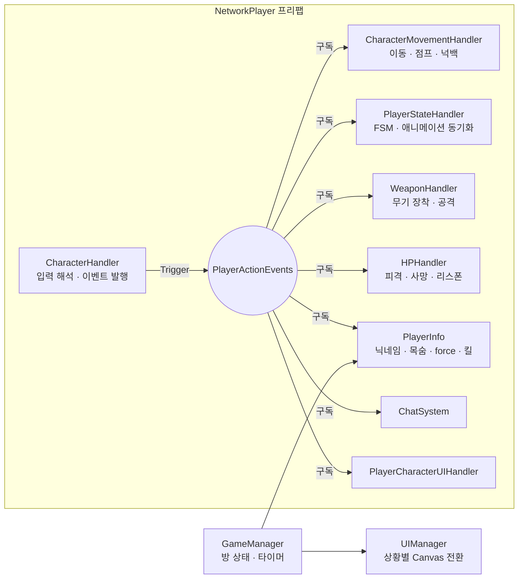
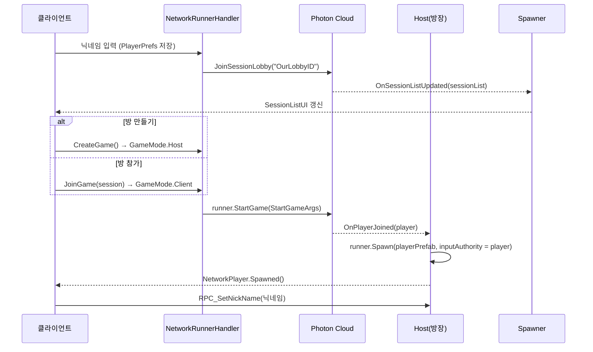
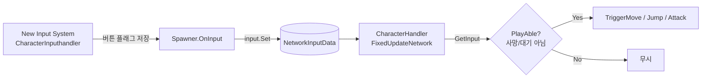
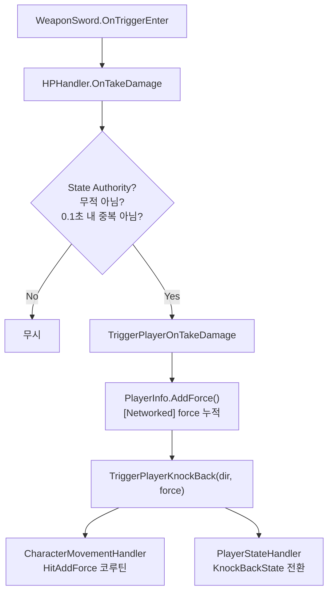
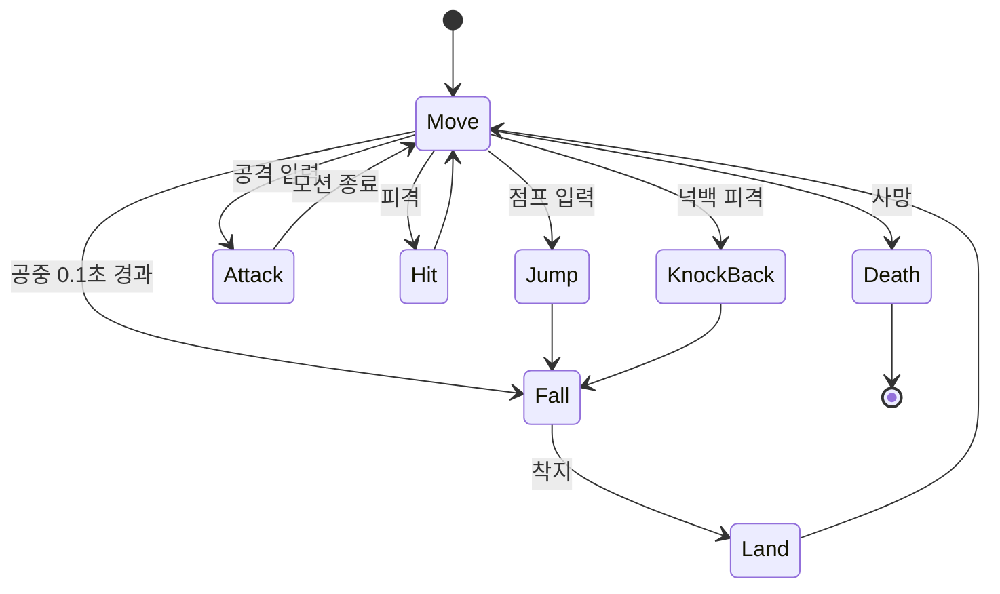
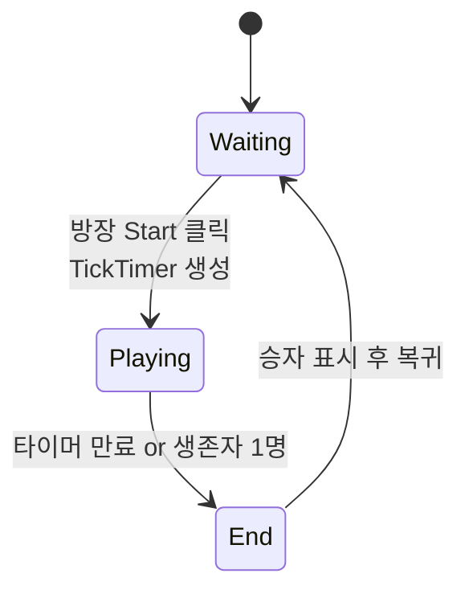

# FusionSmash — Photon Fusion 멀티플레이 대전 게임

대난투 스타일의 2.5D 실시간 PvP 게임입니다. Unity와 Photon Fusion(Host/Client 모드)으로 **1인 개발**했습니다.
맞을수록 넉백 수치(force)가 쌓여 멀리 날아가고, 맵 밖으로 떨어지면 목숨을 잃는 구조입니다.

[](https://youtu.be/HJIhqkEb-mo)

| 항목 | 내용 |
|---|---|
| 엔진 | Unity 2022.3.2 |
| 네트워크 | Photon Fusion 1 (Host Mode, 리슨 서버) |
| 입력 | New Input System (키보드 / 게임패드) |
| 기간 | 2023.11 ~ 2024.04 (개인 프로젝트) |

> 아래 코드는 핵심만 보이도록 줄인 것입니다. 전체 코드는 [`Assets/2Script`](Assets/2Script)에 있습니다.

---

## 1. 전체 구조

플레이어 프리팹 하나에 기능별 컴포넌트를 나눠 붙이고, `PlayerActionEvents`로 묶었습니다.
각 컴포넌트는 서로를 직접 참조하지 않고 **이벤트를 구독**합니다.



`CharacterHandler.Spawned()`에서 각 핸들러가 `IPlayerActionListener` 인터페이스로 이벤트를 구독합니다.

```csharp
public interface IPlayerActionListener
{
    void SubscribeToPlayerActionEvents(ref PlayerActionEvents _playerActionEvents);
}

private void EventSubscribe()
{
    eventHandler = GetComponent<PlayerActionEvents>();
    chatSystem.SubscribeToPlayerActionEvents(ref eventHandler);
    movementHandler.SubscribeToPlayerActionEvents(ref eventHandler);
    playerStateHandler.SubscribeToPlayerActionEvents(ref eventHandler);
    hpHandler.SubscribeToPlayerActionEvents(ref eventHandler);
    weaponHandler.SubscribeToPlayerActionEvents(ref eventHandler);
    characterUIHandler.SubscribeToPlayerActionEvents(ref eventHandler);
    playerInfo.SubscribeToPlayerActionEvents(ref eventHandler);
}
```

---

## 2. 접속 흐름 (로비 → 방 → 스폰)



방을 만든 플레이어가 Host(State Authority)가 되는 **리슨 서버** 구조입니다.
캐릭터 스폰은 서버만 수행합니다.

```csharp
public void OnPlayerJoined(NetworkRunner runner, PlayerRef player)
{
    if (runner.IsServer)
        runner.Spawn(playerPrefab, Utils.GetRandomSpawnPoint(), Quaternion.identity, player);
}
```

---

## 3. 입력 동기화 (매 Tick)

클라이언트는 입력만 보내고, 실제 처리는 `FixedUpdateNetwork`에서 합니다.



```csharp
public override void FixedUpdateNetwork()
{
    if (HasStateAuthority || HasInputAuthority)
    {
        if (GetInput(out NetworkInputData networkInputData))
        {
            Chat(networkInputData);
            if (PlayAble() && playerStateHandler.canMove)
            {
                ActionMove(networkInputData);   // → eventHandler.TriggerMove(x)
                ActionCase(networkInputData);   // → TriggerJump / TriggerAttack
            }
        }
        eventHandler?.TriggerCharacterUpdate();
    }
}
```

버튼 입력은 `GetNetworkInput()`에서 한 번 보낸 뒤 바로 초기화합니다. 그래서 같은 입력이 여러 Tick에서 중복 처리되지 않습니다.

---

## 4. 피격 → 넉백 (대난투 핵심 로직)



판정은 **State Authority(Host)에서만** 합니다. 같은 공격자에게 0.1초 안에 다시 맞으면 무시해서 다단 히트를 막았습니다.

```csharp
public void OnTakeDamage(string enemyname, int weaponNum, Vector3 _attackDir, EAttackType eAttackType, ...)
{
    if (!playerInfo.isDamageAble || !HasStateAuthority) return;

    if (lastHitTime + damageDelay > Time.time && playerInfo.GetEnemyName() == enemyname)
    {
        lastHitTime = Time.time;
        return;                                   // 같은 공격자의 연속 판정 방지
    }
    lastHitTime = Time.time;

    playerInfo.enemyName = enemyname;
    playerActionEvents.TriggerPlayerOnTakeDamage(_addForce);              // force 누적
    if (eAttackType == EAttackType.Knockback)
        playerActionEvents.TriggerPlayerKnockBack(_attackDir, playerInfo.force);
}
```

넉백은 누적된 `force`에 비례합니다. 위쪽 성분을 섞어 대각선으로 날아가게 했고, 여러 프레임에 걸쳐 힘을 줄여 가며 가해 부드럽게 감속합니다.

```csharp
IEnumerator HitAddForce(Vector3 _attackVec)
{
    _attackVec /= 10f;
    float upper = Random.Range(1.2f, 1.8f);
    _attackVec.y = Mathf.Abs(_attackVec.x) / upper;      // 대각선 위로 날림

    int maxC = 12;
    for (int i = 1; i < maxC; i++)
    {
        networkRigidbody.Rigidbody.AddForce((maxC - i) * _attackVec * 10f, ForceMode.Force);
        yield return null;                                // 프레임마다 감쇠
    }
}
```

---

## 5. 플레이어 FSM + 애니메이션 동기화

상태 객체는 각 클라이언트에 있습니다. 네트워크로는 **상태 번호(int)만** `[Networked]`로 보내고, 변경 콜백에서 Animator 파라미터를 맞춥니다.



`PlayerState.Update()`의 전이 우선순위는 **넉백 > 사망 > 피격 > (모션 중 캔슬 불가) > 낙하 > 점프 > 공격 > 이동** 순입니다.
공중에 0.1초 이상 떠 있어야 Fall로 바뀌게 해서 경사나 턱에서 상태가 깜빡이는 현상을 막았습니다.

```csharp
public override bool Update()
{
    if (player.isKnockBack) { player.nextState = player.knockBackState; return true; }
    if (player.isdead)      { player.nextState = player.deathState;     return true; }
    if (player.isHit)       { player.nextState = player.hitState;       return true; }

    if (endMotionChange && player.Isvisi() && !isCancel) return false;   // 모션 잠금

    if (!isAbleFly && !player.IsGround())
    {
        if (airTime == 0f) airTime = Time.time;
        if (Time.time - airTime > 0.1f) { player.nextState = player.fallState; return true; }
    }
    if (player.isJumpButtonPressed && isAbleJump)  { player.nextState = player.jumpState;   return true; }
    if (player.isFireButtonPressed && isAbleAttack){ player.nextState = player.attackState; return true; }
    ...
}
```

---

## 6. 게임 진행 (방 상태)



- `GameManager.roomState`, `TickTimer`는 `[Networked]`이고, Host만 값을 바꿉니다.
- `OnChanged` 콜백에서 `UIManager`가 Canvas(대기/플레이/결과)를 전환합니다.
- 맵 밖(y < -12)으로 떨어지면 `KillSelf()` → `isDead` 동기화 → 화면 페이드 → 2초 뒤 리스폰합니다. 목숨이 0이 되면 관전(Death) 상태가 됩니다.

---

## 7. 채팅

`Enter`로 입력창을 열고 닫습니다. 메시지는 `RpcSources.InputAuthority → RpcTargets.All` RPC로 모든 클라이언트에 보냅니다.

```csharp
[Rpc(RpcSources.InputAuthority, RpcTargets.All)]
public void RPC_SetChat(string mychat, string _sendName, RpcInfo info = default)
{
    sendName = _sendName;
    myChat = mychat;          // OnChanged → PushMessage() 로 채팅 로그에 출력
}
```

---

## 조작법

| 동작 | 키보드 | 게임패드 |
|---|---|---|
| 이동 | A / D | Left Stick |
| 점프 | Space | Button East |
| 공격 | 마우스 좌클릭 | Button South |
| 채팅 | Enter | - |

## 문제 해결 사례

### 1. 클라이언트에서 바꾼 값이 다른 화면에 반영되지 않음
- **문제**: 닉네임 같은 값을 클라이언트가 직접 바꾸면 내 화면에서만 바뀌거나, 잠깐 다른 값으로 보였다가 되돌아갔습니다.
- **원인**: `[Networked]` 속성은 **State Authority(Host)** 가 쓴 값만 모든 클라이언트에 퍼집니다. 클라이언트가 쓴 값은 다음 Tick에 서버 값으로 덮어씌워집니다.
- **해결**: 값 변경은 Host에서만 하고, 클라이언트는 RPC로 **요청만** 보내도록 바꿨습니다.
  ```csharp
  [Rpc(RpcSources.InputAuthority, RpcTargets.StateAuthority)]
  public void RPC_SetNickName(string nickName) => this.nickName = nickName;
  ```
- **결과**: 닉네임, 체력, 상태 번호 등 공유 데이터를 모두 이 규칙으로 정리했고, 화면마다 값이 어긋나는 현상이 사라졌습니다.

### 2. 한 번 휘둘렀는데 여러 번 맞음
- **문제**: 검의 트리거가 Tick마다 다시 겹치면서 공격 한 번에 데미지와 넉백이 여러 번 들어갈 수 있었습니다.
- **해결**: 피격 판정을 Host에서만 하고, **같은 공격자에게 0.1초 안에 다시 맞으면 무시**하도록 했습니다(`HPHandler.OnTakeDamage`).
- **결과**: 공격 한 번에 판정이 한 번만 들어가고, 넉백 수치(force)가 의도한 만큼만 쌓입니다.

### 3. 점프나 공격 입력이 두 번 처리됨
- **문제**: 버튼을 한 번 눌렀는데 여러 Tick에서 같은 입력이 들어와 점프나 공격이 중복될 수 있었습니다.
- **해결**: `GetNetworkInput()`에서 입력을 보낸 직후 버튼 플래그를 `false`로 초기화해서, 한 번 누른 입력은 한 Tick에서만 처리되게 했습니다.

### 4. 지면 경계에서 애니메이션이 깜빡임
- **문제**: 턱이나 경사에서 바닥 체크 Raycast가 잠깐 끊기면 Move와 Fall 상태가 번갈아 바뀌었습니다.
- **해결**: 공중에 **0.1초 이상** 떠 있을 때만 Fall로 바꾸도록 유예 시간을 뒀습니다(`PlayerState.Update`).

### 5. 기능을 추가할수록 스크립트끼리 얽힘
- **문제**: 처음에는 이동, 체력, 무기 스크립트가 서로를 직접 호출해서 하나를 고치면 다른 곳에서 에러가 났습니다.
- **해결**: `PlayerActionEvents`를 가운데 두고 각 핸들러가 이벤트를 **구독**하는 구조로 바꿨습니다(`IPlayerActionListener`).
- **결과**: 무기(Sword/Gun)나 상태를 추가해도 해당 핸들러만 고치면 되게 됐습니다.

## 앞으로 개선할 점
- Fusion 1의 `[Networked(OnChanged)]` 방식은 Fusion 2에서 `ChangeDetector`로 바뀌었기 때문에 이 방식으로 옮기기
- 상태/방 상태를 `int` 대신 `enum`으로 바로 동기화해서 형 변환 줄이기
- `GameObject.Find`로 UI를 찾는 부분을 인스펙터 참조나 매니저로 정리하기
